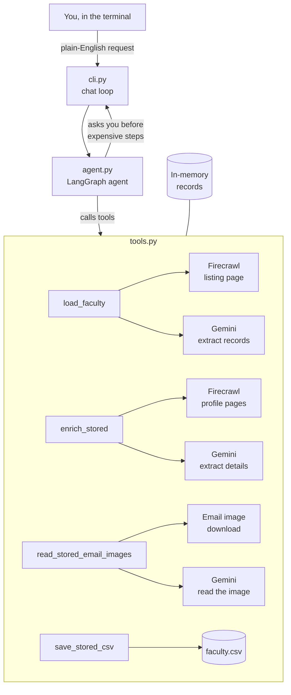

# iceman

A terminal tool that builds a CSV of faculty members from a university faculty page. Give it a faculty directory URL and it extracts each person's name, title, department, email, and research topics, then saves them to a file.

It works across different university website layouts without site-specific code. It has been tested on IISc (CSA and CDS), NUS Computing, and UC Berkeley's Master of Analytics faculty pages.

## What it does

- Reads the faculty listing and extracts everyone on it.
- Visits each person's profile page when the listing is missing an email or research topics.
- Reads email addresses that the site publishes as images.
- Normalizes obfuscated addresses such as `name [AT] domain` and `name(at)domain` into plain addresses.
- Saves the results to a CSV.

## Architecture



The agent runs the steps in order: load, enrich, read images, save. Records are held in memory between steps, so each tool works on the same list.

## Requirements

- Python 3.10 or newer
- [uv](https://docs.astral.sh/uv/) for dependency management
- A [Firecrawl](https://www.firecrawl.dev) API key
- A [Google AI Studio](https://aistudio.google.com) API key (Gemini)

## Setup

Clone the repository and install the dependencies:

```
git clone https://github.com/nodonut6311/iceman.git
cd iceman
uv sync
```

Create a `.env` file in the project root with your keys:

```
FIRECRAWL_API_KEY=fc-your-key-here
GOOGLE_API_KEY=your-gemini-key-here
```

Never commit `.env`. It is already listed in `.gitignore`.

## Usage

Start the tool:

```
uv run iceman
```

Type a request at the `you>` prompt, for example:

```
Make a CSV of faculty from <FACULTY-PAGE-URL-HERE> and save it as <SAMPLE>.csv
```

The assistant loads the records first. Before any step that makes model calls, it reports how many calls it will make and waits for your answer. Reply `yes`, or name a different limit such as `yes, up to 5 profiles`. Type `quit` to exit.

The CSV is written to the project folder.

## Output columns

`name`, `dept`, `title`, `email`, `field_of_work`, `profile_url`

Research topics are separated by semicolons within one cell.

## Things to know

- **Shared addresses.** Some departments publish shared office inboxes (for example `dcsar@nus.edu.sg`) rather than personal addresses. The CSV does not flag these, so check before contacting someone.
- **Caps protect your quota.** Profile fetches and image reads each cost one model call, and free-tier Gemini limits are daily. Ask for a small number first.
- **Imperfect image reads.** Emails read from images are not always exact. Spot-check addresses before relying on them.
- **Network interruptions.** Some sites or networks reset connections under heavy use. If a run hits errors, wait a few minutes or try another network, then run it again. Records that already have an email are skipped.
- **Not every site is covered equally.** Pages that show no emails or topics at all will produce blank fields. Some universities split faculty across several pages or tabs; the tool only reads the URL you give it.

## Project structure

```
src/iceman/tools.py   extraction, enrichment, image reading, CSV output
src/iceman/agent.py   LangGraph agent and its instructions
src/iceman/cli.py     terminal interface
```
